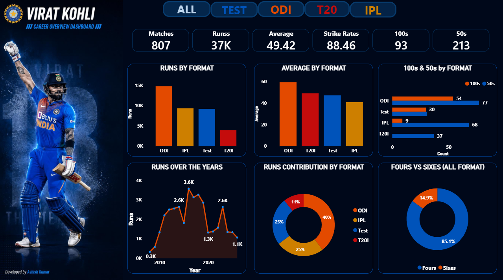
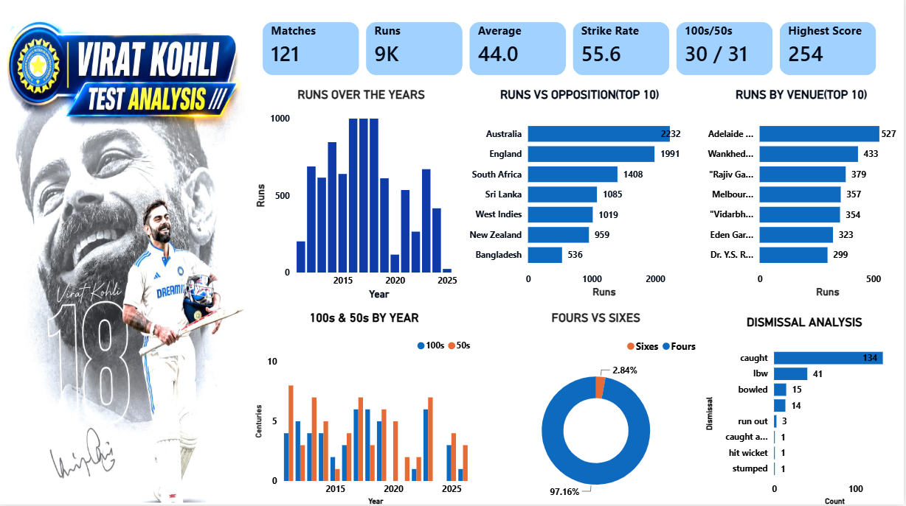
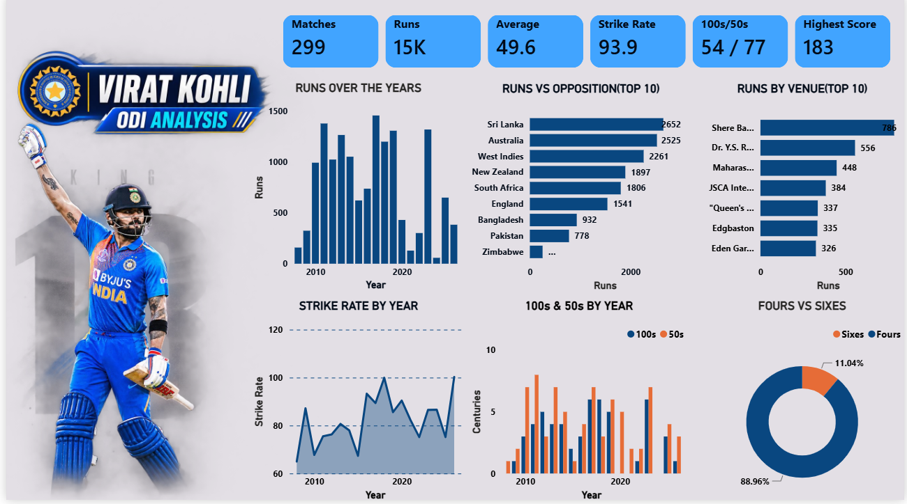
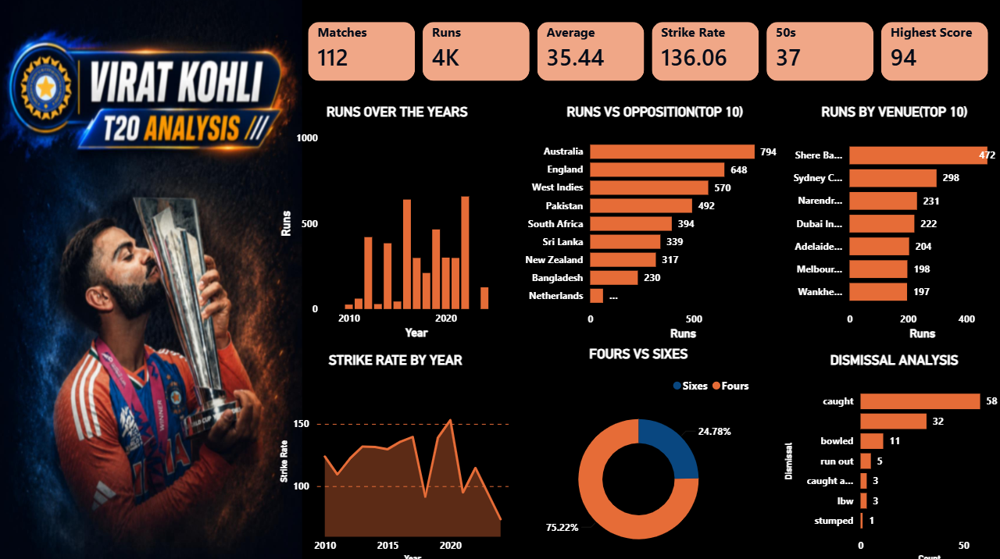
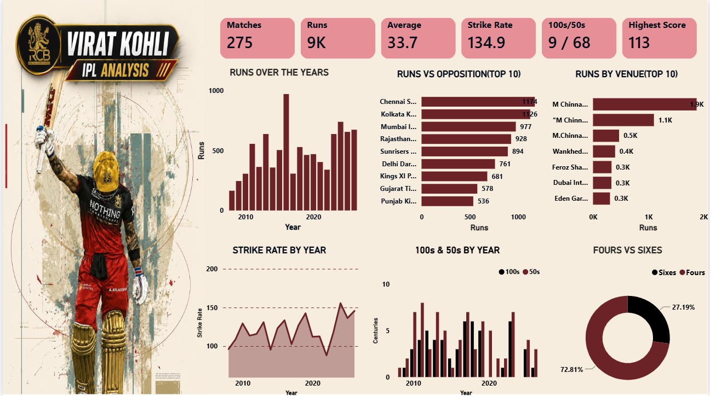

# Virat Kohli Career Analytics | Power BI

## Project Overview
This project analyzes Virat Kohli's cricket career performance and statistics using Microsoft Power BI. It presents cricket performance data through interactive dashboards and format-wise visualizations.

## Project Objectives
- Analyze Virat Kohli's cricket career statistics.
- Explore performance across different cricket formats.
- Present data through interactive Power BI visualizations.
- Make cricket performance data easier to explore and understand.

## Tools & Technologies
- Microsoft Power BI
- Power Query
- DAX
- CSV Dataset

## Project Files

| File | Description |
|---|---|
| `Virat_Kohli.pbix` | Power BI dashboard project |
| `Virat_Kohli_Master.csv` | Master dataset |
| `Dashboard.png` | Main dashboard screenshot |
| `TEST.png` | Test cricket analysis |
| `ODIs.png` | ODI analysis |
| `T20I.png` | T20I analysis |
| `IPL.png` | IPL analysis |

## Dashboard Previews

### Main Dashboard

### Test Cricket

### ODI Cricket

### T20I Cricket

### IPL Cricket

## Skills Demonstrated
- Data Analysis
- Data Visualization
- Dashboard Development
- Power Query
- DAX
- Working with CSV datasets

## Conclusion
This project demonstrates my practical experience in using Power BI to explore cricket performance data and build interactive analytical dashboards.

